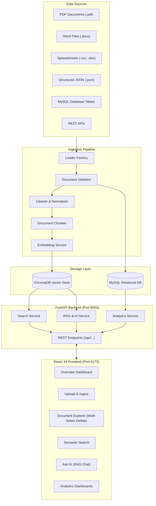

# InsightSphere: Standard Data Pipeline & Analytics Platform

[](https://www.python.org/)
[](https://fastapi.tiangolo.com/)
[](https://react.dev/)
[](https://vitejs.dev/)
[](https://www.trychroma.com/)
[](https://www.mysql.com/)
[](https://docs.pytest.org/)

An enterprise-ready, modular data ingestion and retrieval pipeline designed to seamlessly parse, clean, chunk, embed, and index heterogeneous data sources (unstructured documents and structured datasets) into **ChromaDB** for semantic vector search and **MySQL** for relational persistence.

The platform includes a modern **FastAPI** backend and an intuitive **React 19** web application featuring document exploration with multi-select deletion, semantic search, a context-augmented RAG (Retrieval-Augmented Generation) AI assistant, and interactive analytics dashboards.

---

## Table of Contents

- [Overview](#overview)
- [Key Features](#key-features)
- [System Architecture](#system-architecture)
- [Data Ingestion Pipeline](#data-ingestion-pipeline)
- [Supported Data Formats](#supported-data-formats)
- [Project Directory Structure](#project-directory-structure)
- [Prerequisites](#prerequisites)
- [Getting Started](#getting-started)
  - [1. Clone Repository](#1-clone-repository)
  - [2. Backend Setup](#2-backend-setup)
  - [3. Frontend Setup](#3-frontend-setup)
- [Running the Application](#running-the-application)
- [Environment Configuration](#environment-configuration)
- [API Endpoints Reference](#api-endpoints-reference)
- [Testing](#testing)
- [Common Troubleshooting](#common-troubleshooting)

---

## Overview

Modern organizations deal with fragmented data spread across spreadsheets, reports, databases, and APIs. **InsightSphere** solves this by providing a unified, extensible data pipeline:

1. **Ingest Any Format**: Automatically load files (PDF, Word, CSV, Excel, JSON, TXT) and database tables via dynamic loader factories.
2. **Standard Processing**: Validate document quality, clean noisy content, extract metadata, and split documents into semantic chunks.
3. **Dual-Store Architecture**:
   - **Vector Store (ChromaDB)**: Enables high-speed cosine similarity search, chunk retrieval, and dense embeddings for RAG AI systems.
   - **Relational Store (MySQL)**: Retains relational schemas, transaction records, and analytics-ready datasets.
4. **Interactive Web Application**: Manage data visually, query semantically, chat with your documents, and view executive analytics dashboards.

---

## Key Features

### 1. Multi-Format Ingestion Engine
- **Automated Loader Factory**: Dynamically selects the appropriate parser based on file extension or source type.
- **Supported Formats**: CSV, Excel (`.xlsx`, `.xls`), JSON, PDF, Microsoft Word (`.docx`), Plain Text (`.txt`), MySQL queries, and REST APIs.
- **Batch Processing**: Capable of streaming large datasets in configurable batch sizes to prevent memory overflow.

### 2. Intelligent Document Processing
- **Quality Validation**: Automatically checks documents for required fields, content integrity, character encoding, and minimum quality thresholds.
- **Cleaning & Normalization**: Strips excessive whitespace, invisible unicode artifacts, and standardizes text formats.
- **Semantic Chunking**: Splits large documents into manageable, overlapping chunks to preserve contextual coherence for vector search.

### 3. Dual Storage Layers
- **ChromaDB Vector Database**: Persists document chunk embeddings, source metadata, and supports fast vector-based similarity retrieval.
- **MySQL Relational Database**: Handles structured relational records with connection pooling, automatic failover checks, and schema validation.

### 4. Semantic Search & RAG AI Assistant
- **Semantic Vector Search**: Search documents by conceptual meaning rather than exact keyword matches.
- **Context Builder**: Augments user prompts with retrieved context chunks for grounding LLM responses.
- **AI Assistant**: Natural language Q&A interface with source citations and document references.

### 5. Interactive React 19 Frontend
- **Overview Dashboard**: Live statistics (total indexed chunks, database connections, health metrics).
- **Upload & Ingestion Studio**: Drag-and-drop document upload with real-time feedback and validation summaries.
- **Document Explorer**:
  - Filter and inspect document chunks with detailed JSON metadata preview.
  - Individual document deletion.
  - **Multiple Selection & Batch Deletion**: Select individual or all documents across a page and delete them from ChromaDB in a single batch operation.
- **Semantic Search Playground**: Test natural language queries with similarity scoring.
- **Ask AI Interface**: Chat with your knowledge base.
- **Analytics Dashboards**: Visual charts for revenue, customer segmentation (RFM), transaction anomalies, and product metrics.
- **Theme Switcher**: Built-in support for sleek Dark and Light modes.

---

## System Architecture



---

## Data Ingestion Pipeline

When a file or database source is ingested, it passes through sequential pipeline stages:

```
Input File / Source
       ↓
[ 1. Loader Factory ]       → Selects specialized loader (PDF, DOCX, CSV, JSON, etc.)
       ↓
[ 2. Document Validator ]   → Checks quality score, missing values, and empty text
       ↓
[ 3. Document Cleaner ]     → Normalizes whitespace, strips noise and invalid characters
       ↓
[ 4. Document Chunker ]     → Splits text into semantic chunks with overlap
       ↓
[ 5. Embedding Service ]    → Generates dense vector representations (ChromaDB / HuggingFace)
       ↓
[ 6. Dual Persistence ]     → Indexes vectors in ChromaDB & stores structured records in MySQL
```

---

## Supported Data Formats

| Format | Extension | Loader Class | Description |
| :--- | :--- | :--- | :--- |
| **CSV** | `.csv` | `CSVLoader` | Tabular row-by-row parsing with metadata tagging |
| **Excel** | `.xlsx`, `.xls` | `ExcelLoader` | Multi-sheet spreadsheet ingestion |
| **JSON** | `.json` | `JSONLoader` | Structured or semi-structured JSON objects & arrays |
| **PDF** | `.pdf` | `PDFLoader` | Extracts textual pages using `pypdf` |
| **Word** | `.docx` | `DocxLoader` | Paragraph extraction via `python-docx` |
| **Text** | `.txt` | `TxtLoader` | Plain text files with line/paragraph parsing |
| **MySQL** | `N/A` | `MySQLLoader` | Table extraction and custom SQL queries |
| **API** | `N/A` | `APILoader` | HTTP GET data fetch from external REST endpoints |

---

## Project Directory Structure

```text
standard-data-pipline/
├── app/                              # Core Python backend & pipeline
│   ├── ai/                           # AI processor and LLM integration
│   ├── analytics/                    # Business analytics (RFM, anomaly detection, revenue)
│   ├── api/                          # FastAPI REST application
│   │   ├── __init__.py
│   │   └── app.py                    # API endpoints, request models & routes
│   ├── config/                       # Settings management via pydantic-settings
│   │   └── settings.py
│   ├── embeddings/                   # Vector embedding services & providers
│   ├── llm/                          # LLM client abstractions
│   ├── loaders/                      # Modular loaders (PDF, CSV, JSON, DOCX, MySQL, etc.)
│   ├── logging/                      # Structured logging utilities
│   ├── models/                       # Internal data models (Document, Chunk, etc.)
│   ├── pipeline/                     # Ingestion and batch pipeline coordinator
│   │   └── ingestion_pipeline.py
│   ├── processors/                   # Text parser, cleaner, and chunker
│   ├── rag/                          # Context builder and RAG service
│   ├── search/                       # Semantic vector search engine
│   ├── storage/                      # Database connectors (ChromaDB, MySQL)
│   ├── ui/services/                  # Dashboard aggregators and data formatters
│   ├── utils/                        # General helper utilities
│   ├── validation/                   # Document quality validators & summaries
│   └── main.py                       # CLI entry point for standalone pipeline runs
│
├── frontend/                         # Modern React 19 Frontend
│   ├── public/                       # Static public assets
│   ├── src/
│   │   ├── components/               # Header, Sidebar, Charts, UI components
│   │   ├── pages/
│   │   │   ├── OverviewPage.jsx      # High-level system overview & metrics
│   │   │   ├── UploadPage.jsx        # File upload & ingestion studio
│   │   │   ├── ExplorePage.jsx       # Document Explorer with batch delete
│   │   │   ├── SearchPage.jsx        # Semantic search interface
│   │   │   ├── AskAIPage.jsx         # RAG AI assistant & chat
│   │   │   ├── DashboardsPage.jsx    # Analytics charts & intelligence
│   │   │   └── SettingsPage.jsx      # Configuration & connection health
│   │   ├── App.jsx                   # Root layout, router, theme management
│   │   ├── index.css                 # Enterprise Design System (Tokens, Dark/Light modes)
│   │   └── main.jsx                  # React application entry point
│   ├── package.json                  # Frontend dependencies and scripts
│   └── vite.config.js                # Vite build and reverse proxy configuration
│
├── data/                             # Data directory (ChromaDB persistence storage)
│   └── chroma/
├── tests/                            # Comprehensive Pytest test suite (223+ tests)
├── .env.example                      # Sample environment variables template
├── requirements.txt                  # Python dependencies
├── pyproject.toml                    # Python project packaging metadata
└── README.md                         # Project documentation
```

---

## Prerequisites

Before running the application, ensure you have:

- **Python**: Version `3.10` or higher
- **Node.js**: Version `18.0` or higher (includes `npm`)
- **MySQL** *(Optional)*: If using relational persistence (default: `localhost:3306`)

---

## Getting Started

### 1. Clone Repository

```bash
git clone https://github.com/your-username/standard-data-pipline.git
cd standard-data-pipline
```

### 2. Backend Setup

1. **Create and activate a virtual environment**:
   ```bash
   # Windows (PowerShell)
   python -m venv .venv
   .venv\Scripts\Activate.ps1

   # macOS / Linux
   python3 -m venv .venv
   source .venv/bin/activate
   ```

2. **Install Python dependencies**:
   ```bash
   pip install --upgrade pip
   pip install -r requirements.txt
   ```

3. **Configure Environment Variables**:
   Copy `.env.example` to `.env`:
   ```bash
   cp .env.example .env
   ```
   *(See the [Environment Configuration](#environment-configuration) section for details.)*

### 3. Frontend Setup

1. **Navigate to the frontend folder**:
   ```bash
   cd frontend
   ```

2. **Install frontend dependencies**:
   ```bash
   npm install
   ```

3. **Return to the root folder**:
   ```bash
   cd ..
   ```

---

## Running the Application

### Option A: Running the Full Platform (Backend + UI)

1. **Start the FastAPI Backend** (Terminal 1):
   ```bash
   # From project root
   .venv\Scripts\python -m uvicorn app.api.app:app --host 127.0.0.1 --port 8000 --reload
   ```
   *The backend will be running at [http://127.0.0.1:8000](http://127.0.0.1:8000) with interactive Swagger docs at [http://127.0.0.1:8000/docs](http://127.0.0.1:8000/docs).*

2. **Start the Frontend Dev Server** (Terminal 2):
   ```bash
   cd frontend
   npm run dev
   ```
   *Open [http://localhost:5173](http://localhost:5173) in your web browser.*

---

### Option B: Running the Pipeline via CLI

You can also run the ingestion pipeline directly from the command line on any supported file:

```bash
# Ingest a CSV file
python -m app.main sample.csv

# Ingest a JSON file
python -m app.main sample.json

# Ingest a PDF document
python -m app.main sample.pdf

# Ingest a Word document
python -m app.main sample.docx
```

---

## Environment Configuration

Configuration is managed via Pydantic in [`app/config/settings.py`](file:///d:/project/standard-data-pipline/app/config/settings.py) and can be customized via `.env`:

| Variable | Default Value | Description |
| :--- | :--- | :--- |
| `APP_NAME` | `Standard Data Pipeline` | Name displayed across logs and API metadata |
| `ENVIRONMENT` | `development` | Environment mode (`development`, `production`) |
| `LOG_LEVEL` | `INFO` | Logging level (`DEBUG`, `INFO`, `WARNING`, `ERROR`) |
| `BATCH_SIZE` | `1000` | Number of documents processed per batch |
| `CHROMA_PATH` | `data/chroma` | Directory for persistent ChromaDB storage |
| `CHROMA_COLLECTION` | `documents` | Default ChromaDB collection name |
| `AI_ENABLED` | `True` | Flag to enable AI enrichment & embeddings |
| `EMBEDDING_PROVIDER` | `chromadb` | Vector embedding engine (`chromadb`, `openai`) |
| `LLM_PROVIDER` | `mock` | LLM generation model (`mock`, `openai`) |
| `OPENAI_API_KEY` | `None` | Optional API key for OpenAI embedding/generation |
| `MYSQL_HOST` | `localhost` | MySQL hostname or IP address |
| `MYSQL_PORT` | `3306` | MySQL database port |
| `MYSQL_USER` | `root` | MySQL database user |
| `MYSQL_PASSWORD` | `""` | MySQL database password |
| `MYSQL_DATABASE` | `big_data_demo` | MySQL database name |

---

## API Endpoints Reference

FastAPI automatically generates interactive Swagger documentation at **`http://127.0.0.1:8000/docs`**.

### Overview & Diagnostics
- `GET /api/health` — Returns status of ChromaDB, MySQL connection, and memory health.
- `GET /api/overview` — High-level summary of total indexed records and database status.

### Document Management & Ingestion
- `POST /api/upload` — Uploads and triggers automated ingestion of documents (`.pdf`, `.docx`, `.csv`, `.json`, etc.).
- `GET /api/documents` — Lists indexed document chunks with pagination (`limit`, `offset`) and keyword search.
- `DELETE /api/documents/{doc_id}` — Deletes an individual document chunk from ChromaDB by ID.
- `POST /api/documents/batch-delete` — Deletes multiple document chunks by ID list in a single batch request:
  ```json
  {
    "ids": ["doc_chunk_1", "doc_chunk_2", "doc_chunk_3"]
  }
  ```

### Semantic Search & RAG
- `POST /api/search` — Performs dense semantic vector search over document embeddings.
  ```json
  {
    "query": "revenue trends for electronic products",
    "n_results": 5
  }
  ```
- `POST /api/rag` — Context-grounded Question Answering using retrieved knowledge chunks.

### Analytics
- `GET /api/dashboards` — Computes comprehensive business intelligence summaries (RFM customer segments, anomaly detection, revenue breakdown, product performance).

---

## Testing

The project maintains test coverage with **223 unit and integration tests** verifying loaders, chunkers, cleaners, embedding services, vector storage, and API routes.

### Run Python Tests
```bash
# Run the entire test suite
.venv\Scripts\pytest

# Run tests with short summary
.venv\Scripts\pytest -q
```

### Run Frontend Linting & Build Verification
```bash
cd frontend

# Run fast code linter (oxlint)
npm run lint

# Build production bundle
npm run build
```

---

## Common Troubleshooting

### 1. MySQL Shows "Disconnected" or "Unavailable"
- **Cause**: MySQL server is not running on `localhost:3306` or credentials in `.env` are unset.
- **Resolution**: Verify MySQL service is active. Note that the vector pipeline and ChromaDB function independently even if MySQL is offline.

### 2. Port Already in Use (8000 or 5173)
- If port `8000` is occupied:
  ```bash
  uvicorn app.api.app:app --port 8001
  ```
  *(Update `frontend/vite.config.js` proxy target accordingly).*
- If port `5173` is occupied, Vite will automatically suggest port `5174`.

### 3. ChromaDB Reset / Clean Slate
- To clear all indexed vector documents and reset storage:
  ```bash
  # Delete the local chroma persistence directory
  rmdir /s /q data\chroma
  ```
  The pipeline will automatically recreate a fresh database collection on the next run.

---

## License

This project is licensed under the MIT License. Feel free to use, modify, and distribute as needed.
