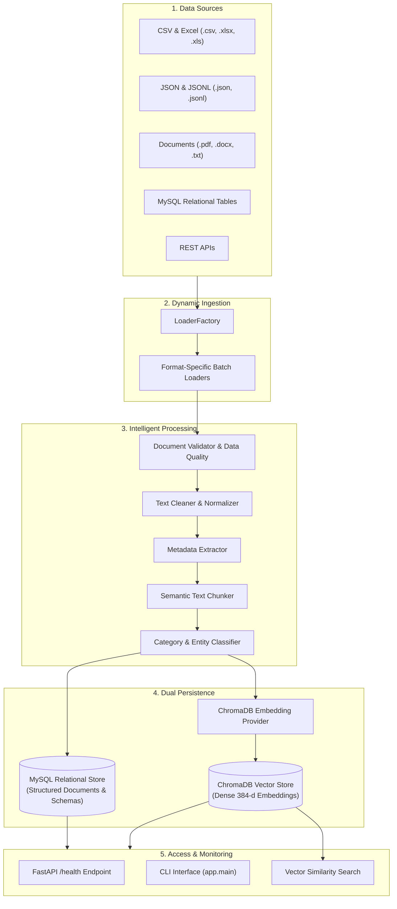

# InsightSphere: Standard Data Ingestion & Retrieval Pipeline

[](https://www.python.org/)
[](https://fastapi.tiangolo.com/)
[](https://www.trychroma.com/)
[](https://www.mysql.com/)
[](https://docs.pytest.org/)
[]()

An enterprise-grade, modular data ingestion and retrieval engine engineered to ingest, clean, chunk, classify, embed, and store both unstructured documents and structured tabular datasets into **ChromaDB** for semantic vector similarity search and **MySQL** for relational persistence.

This `prod` branch contains the core, stabilized backend data pipeline with production health-monitoring endpoints, database connectors, and automated quality validation.

---

## Table of Contents

- [Overview & Architecture](#overview--architecture)
- [Key Features](#key-features)
- [Supported Data Formats](#supported-data-formats)
- [Prerequisites](#prerequisites)
- [Quickstart Guide](#quickstart-guide)
  - [1. Clone and Checkout](#1-clone-and-checkout)
  - [2. Virtual Environment Setup](#2-virtual-environment-setup)
  - [3. Install Dependencies](#3-install-dependencies)
  - [4. Configure Environment Variables](#4-configure-environment-variables)
- [How to Run the Pipeline](#how-to-run-the-pipeline)
  - [A. Ingest Files via Command-Line (CLI)](#a-ingest-files-via-command-line-cli)
  - [B. Ingest from MySQL Database](#b-ingest-from-mysql-database)
  - [C. Run the Production FastAPI Server](#c-run-the-production-fastapi-server)
- [System Verification & Diagnostic Scripts](#system-verification--diagnostic-scripts)
- [Running the Test Suite](#running-the-test-suite)
- [Project Directory Structure](#project-directory-structure)
- [Configuration Reference](#configuration-reference)
- [Troubleshooting & FAQ](#troubleshooting--faq)

---

## Overview & Architecture

InsightSphere solves fragmented data workflows by standardizing the ingestion lifecycle across disparate file formats, relational tables, and REST endpoints:



---

## Key Features

1. **Universal Loader Factory**: Automatically detects file extensions and delegates to dedicated, memory-safe loaders (streaming support for large `.jsonl`, `.csv`, `.xlsx`).
2. **Automated Quality Validation**: Computes record-level completeness, character validity, schema conformity, and issues automated quality summary scores.
3. **Data Normalization & Cleaning**: Strips null bytes, invisible unicode artifacts, trailing whitespaces, and standardizes encodings.
4. **Smart Chunking**: Segments long-form prose and reports into contextual overlapping chunks to prevent information loss during vector retrieval.
5. **Dual-Store Resilience**:
   - **Vector Store (ChromaDB)**: Automatic local vector indexing using 384-dimensional dense sentence embeddings.
   - **Relational Store (MySQL)**: Persistent SQL storage with engine pooling, schema checks, and automatic fallback.
6. **Production Health Checks**: Standardized `/health` API endpoint evaluating database connectivity, vector index readiness, and system degradation.

---

## Supported Data Formats

| Format | Extension | Processing Mode | Typical Use Case |
| :--- | :--- | :--- | :--- |
| **Comma-Separated Values** | `.csv` | Tabular row-to-document | Customer data, financial records |
| **Excel Workbooks** | `.xlsx`, `.xls` | Sheet & row extraction | Business spreadsheets, inventory |
| **JSON Objects** | `.json` | Key-value & nested documents | API payloads, configuration dumps |
| **JSON Lines** | `.jsonl` | Batched chunk streaming | High-volume transactional logs |
| **PDF Documents** | `.pdf` | Page-by-page text extraction | Reports, research papers, legal forms |
| **Microsoft Word** | `.docx` | Paragraph & block extraction | Contracts, internal documentation |
| **Plain Text** | `.txt` | Line-buffered ingestion | System logs, unstructured notes |
| **MySQL Database** | Table / Query | Direct SQL connection & batch fetch | Enterprise transactional systems |
| **REST APIs** | HTTP GET | Paginated JSON payload loader | External data feeds & microservices |

---

## Prerequisites

Before setting up the project, make sure the following tools are installed:

- **Python**: Version `3.10`, `3.11`, or `3.12` ([Download Python](https://www.python.org/downloads/))
- **Git**: Installed and configured ([Download Git](https://git-scm.com/))
- **MySQL Server** *(Optional)*: If utilizing relational database persistence (default: port `3306`)

---

## Quickstart Guide

### 1. Clone and Checkout

```bash
# Clone the repository
git clone https://github.com/aieternity2-max/standard-data-pipline.git
cd standard-data-pipline

# Checkout the production branch
git checkout prod
```

### 2. Virtual Environment Setup

Isolate project dependencies using Python's built-in `venv`:

```bash
# Windows (PowerShell)
python -m venv .venv
.venv\Scripts\Activate.ps1

# Linux / macOS
python3 -m venv .venv
source .venv/bin/activate
```

### 3. Install Dependencies

Upgrade `pip` and install all necessary production requirements:

```bash
pip install --upgrade pip
pip install -r requirements.txt
```

### 4. Configure Environment Variables

Create your local `.env` configuration from the provided template:

```bash
# Windows (PowerShell)
Copy-Item .env.example .env

# Linux / macOS
cp .env.example .env
```

Open `.env` in any text editor and adjust values as needed:

```env
APP_NAME="Standard Data Pipeline"
ENVIRONMENT=production
LOG_LEVEL=INFO
BATCH_SIZE=1000

# MySQL Configuration (Optional if only testing vector store)
MYSQL_HOST=localhost
MYSQL_PORT=3306
MYSQL_USER=your_user
MYSQL_PASSWORD=your_password
MYSQL_DATABASE=big_data_demo
```

---

## How to Run the Pipeline

### A. Ingest Files via Command-Line (CLI)

The pipeline provides a direct CLI entry point in `app/main.py`. Pass any supported file path to automatically process, validate, and store it:

```bash
# Ingest sample CSV file
python -m app.main sample.csv

# Ingest sample JSON file
python -m app.main sample.json

# Ingest PDF or Word documents
python -m app.main path/to/document.pdf
python -m app.main path/to/document.docx
```

**Sample Output:**
```text
============================================================
InsightSphere Ingestion Pipeline
============================================================
Loaded 10 documents from 'sample.csv'.
Quality Check: 10/10 valid records (Score: 100.0%)
Chunks generated: 10
Saved to ChromaDB: 10 vectors
Saved to MySQL: 10 records
Pipeline execution completed successfully.
```

---

### B. Ingest from MySQL Database

To ingest directly from an active MySQL table into the pipeline:

```bash
python -m app.run_mysql_ingestion
```

This connects to the configured MySQL database, extracts records using `MySQLLoader`, runs validation and chunking, and indexes the records into ChromaDB for vector search.

---

### C. Run the Production FastAPI Server

InsightSphere includes a lightweight FastAPI service for system health monitoring and integration probes:

```bash
# Start the FastAPI application with Uvicorn
python -m uvicorn app.api.app:app --host 0.0.0.0 --port 8000
```

Once running, access the following endpoints:
* **Interactive Swagger UI**: [http://localhost:8000/docs](http://localhost:8000/docs)
* **System Health Check**: [http://localhost:8000/health](http://localhost:8000/health)

**Sample Health Check Response (`GET /health`):**
```json
{
  "status": "healthy",
  "service": "Standard Data Pipeline",
  "database": "healthy",
  "vector_store": "healthy"
}
```

---

## System Verification & Diagnostic Scripts

The repository includes ready-to-run verification utilities in the root directory:

| Script | Purpose | Command |
| :--- | :--- | :--- |
| **`verify_vector.py`** | Inspects ChromaDB document count and executes a sample similarity search | `python verify_vector.py` |
| **`verify_sql.py`** | Validates MySQL connectivity and inspects sample records | `python verify_sql.py` |
| **`create_sample_pdf.py`** | Generates a synthetic `.pdf` file in the workspace for testing | `python create_sample_pdf.py` |
| **`create_sample_docx.py`** | Generates a synthetic `.docx` file in the workspace for testing | `python create_sample_docx.py` |

---

## Running the Test Suite

The codebase has complete unit and integration test coverage using `pytest`.

To run all 98 automated tests:

```bash
# Run pytest across all test files
pytest

# Run with verbose output
pytest -v

# Run a specific test suite
pytest tests/test_pipeline.py
pytest tests/test_loader_factory.py
```

**Expected Result:**
```text
============================= 98 passed in ~11s =============================
```

---

## Project Directory Structure

```text
standard-data-pipline/
│
├── app/                              # Core application source code
│   ├── ai/                           # AI categorization and extraction
│   │   ├── ai_processor.py           # Pipeline processor for metadata
│   │   ├── classifier.py             # Rule-based and text classification
│   │   └── extractor.py              # Information extraction
│   │
│   ├── api/                          # REST API services
│   │   ├── app.py                    # FastAPI application definition
│   │   └── health.py                 # Health probe endpoint (/health)
│   │
│   ├── config/                       # Configuration modules
│   │   ├── database.py               # SQLAlchemy database engine builder
│   │   └── settings.py               # Pydantic Settings & environment loader
│   │
│   ├── embeddings/                   # Embedding generation services
│   │   ├── base.py                   # Abstract embedding provider interface
│   │   └── embedding_service.py      # Embedding generation & text prep
│   │
│   ├── loaders/                      # Format-specific document loaders
│   │   ├── api_loader.py             # REST API paginated loader
│   │   ├── base.py                   # Base document loader interface
│   │   ├── csv_loader.py             # CSV reader & batch parser
│   │   ├── database_loader.py        # Generic database SQL reader
│   │   ├── docx_loader.py            # Microsoft Word document loader
│   │   ├── excel_loader.py           # Excel (.xlsx, .xls) workbook loader
│   │   ├── json_loader.py            # JSON and JSONL batch loaders
│   │   ├── loader_factory.py         # Dynamic format-to-loader dispatcher
│   │   ├── mysql_loader.py           # Dedicated MySQL batch extractor
│   │   ├── pdf_loader.py             # PDF text parser (pypdf)
│   │   └── txt_loader.py             # Plain text parser
│   │
│   ├── logging/                      # Structured application logger
│   │   └── logger.py
│   │
│   ├── models/                       # Core domain entities
│   │   └── document.py               # Standardized Document data model
│   │
│   ├── pipeline/                     # Ingestion orchestrator
│   │   └── ingestion_pipeline.py     # Coordinates validate -> clean -> chunk -> store
│   │
│   ├── processors/                   # Text transformation components
│   │   ├── chunker.py                # Overlapping text chunker
│   │   ├── cleaner.py                # Text normalization & cleaner
│   │   └── parser.py                 # Structured dictionary parser
│   │
│   ├── storage/                      # Storage persistence layer
│   │   ├── sql_storage.py            # MySQL database adapter (SQLAlchemy)
│   │   └── vector_storage.py         # ChromaDB client & vector operations
│   │
│   ├── validation/                   # Data quality verification
│   │   ├── data_quality.py           # Field-level & score validator
│   │   ├── document_validator.py     # Document structure verification
│   │   └── quality_summary.py        # Pipeline quality aggregator
│   │
│   ├── main.py                       # CLI execution entry point
│   └── run_mysql_ingestion.py        # MySQL ingestion script
│
├── data/                             # Local data directory
│   └── chroma/                       # ChromaDB persistent collection files
│
├── tests/                            # Automated Pytest test suite (98 tests)
│   ├── fixtures/                     # Test sample files (.csv, .pdf, .json, etc.)
│   └── test_*.py                     # Unit tests for all components
│
├── .env.example                      # Template for environment variables
├── pyproject.toml                    # Project package metadata & test settings
├── requirements.txt                  # Python dependencies
├── sample.csv                        # Sample CSV test dataset
├── sample.json                       # Sample JSON test dataset
├── verify_sql.py                     # Script to verify MySQL connection
├── verify_vector.py                  # Script to verify ChromaDB vector store
└── README.md                         # Project documentation
```

---

## Configuration Reference

All settings can be configured via environment variables or a `.env` file located in the project root:

| Variable | Type | Default | Description |
| :--- | :--- | :--- | :--- |
| `APP_NAME` | `str` | `Standard Data Pipeline` | Name of the application service |
| `ENVIRONMENT` | `str` | `development` | Deployment environment (`development`, `production`, `testing`) |
| `LOG_LEVEL` | `str` | `INFO` | Console log verbosity (`DEBUG`, `INFO`, `WARNING`, `ERROR`) |
| `BATCH_SIZE` | `int` | `1000` | Default batch size for streaming large datasets |
| `MYSQL_HOST` | `str` | `localhost` | Hostname or IP of the MySQL server |
| `MYSQL_PORT` | `int` | `3306` | Port for the MySQL database service |
| `MYSQL_USER` | `str` | *(empty)* | Username for MySQL authentication |
| `MYSQL_PASSWORD` | `str` | *(empty)* | Password for MySQL authentication |
| `MYSQL_DATABASE` | `str` | *(empty)* | Target database schema name |

---

## Troubleshooting & FAQ

### 1. `(pymysql.err.OperationalError) (2003, "Can't connect to MySQL server")`
* **Cause**: MySQL service is not running or the hostname/port in `.env` is incorrect.
* **Fix**: Ensure your MySQL server is running (`systemctl status mysql` or check Windows Services). If you do not require MySQL, vector ingestion to ChromaDB will continue to function independently.

### 2. `ChromaDB: permission denied or database locked`
* **Cause**: Another process or background worker has an active lock on `data/chroma/chroma.sqlite3`.
* **Fix**: Terminate any dangling Python or uvicorn processes, or check file permissions on the `data/` directory.

### 3. PDF Parsing Error: `PdfReadError`
* **Cause**: The PDF file is either password-encrypted, corrupted, or scanned as a pure image (non-OCR).
* **Fix**: Verify the file opens in a regular viewer. For image-only PDFs, apply OCR preprocessing prior to ingestion.

### 4. Running without MySQL
* InsightSphere is architected with graceful degradation. If MySQL credentials are not configured, the ingestion pipeline will continue to parse, clean, chunk, and index vectors directly into ChromaDB.

---

## License

This project is licensed under the MIT License — see the LICENSE file for details.
